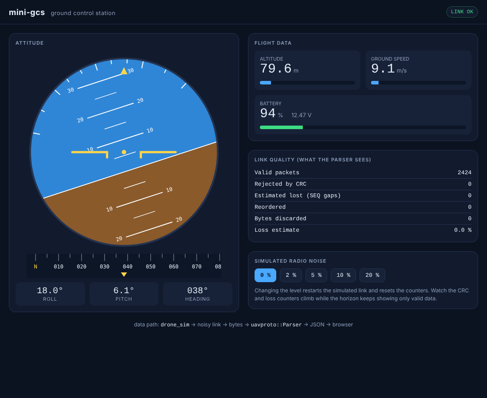

# mini-gcs

A small ground control station (GCS) that shows live drone telemetry in the browser: an artificial horizon,
heading tape, altitude, speed, battery and a **link quality panel** that shows what the parser is rejecting.

It is the second half of a pair with [`uav-telemetry-protocol`](https://github.com/zackyhaqqi21/uav-telemetry-protocol):
the protocol library encodes and parses the packets, and this project puts a dashboard on top of it.
There is no real drone here. A simulator flies a made-up pattern and sends its telemetry through the protocol,
optionally over a deliberately bad link.



At 10 % simulated radio noise the parser rejects damaged packets and the horizon only ever shows valid data:


## How it works

```
drone_sim ──► NoisyLink ──► raw bytes ──► gcs_bridge ──► JSON lines ──► server.py ──► browser
(encode)     (bit flips,    (stdout/      (uavproto::      (stdout)     (SSE stream)  (canvas
              drops, ...)    pipe)         Parser)                                    dashboard)
```

| Part | File | What it does |
|---|---|---|
| Drone simulator | `src/drone_sim.cpp` | Flies a banking/climbing pattern, builds `ATTITUDE`, `ALT_SPEED`, `BATTERY` and `HEARTBEAT` packets with `uavproto::encode`, and sends them through the noisy link |
| Ground-station bridge | `src/gcs_bridge.cpp` | Reads the byte stream, runs `uavproto::Parser`, prints one JSON line per **valid** packet plus link stats |
| Server | `server/server.py` | Python standard library only. Runs the two programs above, streams their output to the browser (Server-Sent Events), and lets the page change the noise level |
| Dashboard | `server/dashboard.html` | One file, no external libraries. Artificial horizon and heading tape drawn on canvas |
| Protocol library | `lib/` | Copy of `protocol.*` and `noisy_link.*` from `uav-telemetry-protocol` |

## Build and run

Needs a C++17 compiler (`g++`) and Python 3. Linux, macOS or WSL (the bridge uses POSIX `read`).

```bash
make            # builds build/drone_sim and build/gcs_bridge
make test       # 1 s of flight at 5 % noise, prints the last JSON lines
make run        # starts the server, then open http://127.0.0.1:8000
```

Options: `python3 server/server.py --port 8000 --noise 0.05 --rate 50`.
The buttons on the page change the simulated noise while it runs.

## What the dashboard shows

- **Attitude:** roll, pitch and heading from `MSG_ATTITUDE` (int16 centi-degrees).
  The bank scale rotates with the horizon and the yellow index stays fixed, like a real attitude indicator.
- **Flight data:** altitude (cm) and ground speed (cm/s) from `MSG_ALT_SPEED`, battery voltage and percent from `MSG_BATTERY`.
- **Link quality:** valid packets, CRC rejections, estimated lost packets (from SEQ gaps), reordered packets,
  discarded bytes. The `LINK OK` badge turns red when no valid packet has arrived for one second.

## Limitations

- The drone is a simulator. Nothing here is connected to a real flight controller yet.
- The input is a pipe from the simulator. Reading a real serial port or UDP socket would only replace `drone_sim`.
- With heavy noise the parser can hold back data for a moment: a false `0xAA` followed by a large `LEN`
  waits for more bytes before it is rejected (see the limitations in `uav-telemetry-protocol`).
- The simulated flight is not a physical model.

## Next steps

- [ ] Read telemetry from ArduPilot SITL (MAVLink) and convert it to this protocol
- [ ] Flight log recorder and replay ("black box")
- [ ] Read from a real serial port or UDP socket
