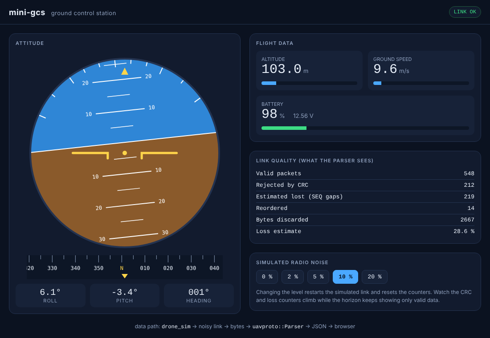
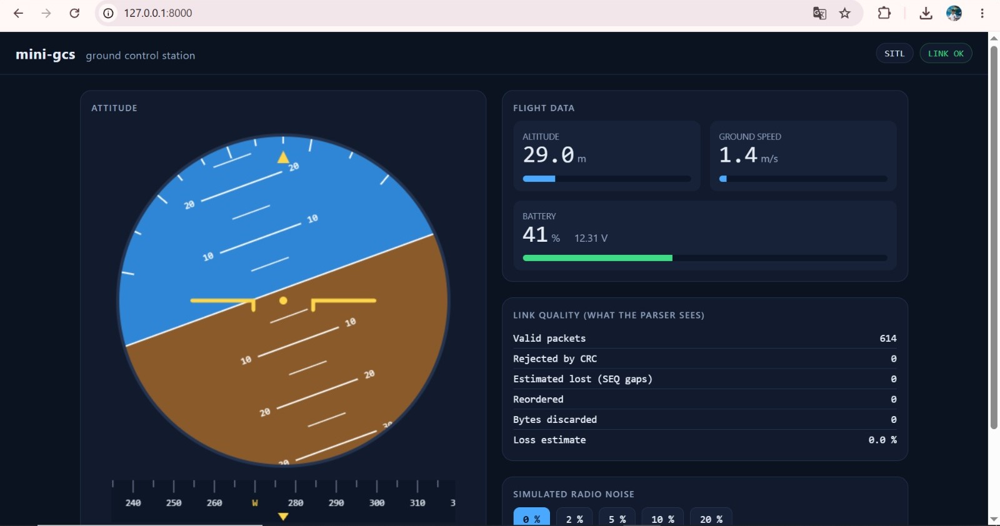
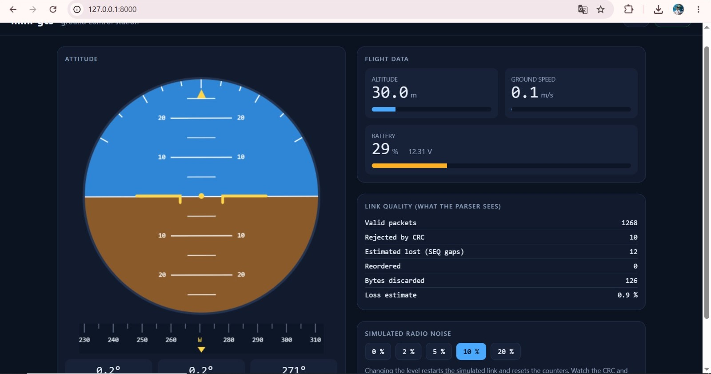
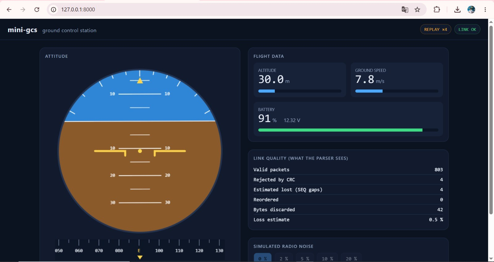

# mini-gcs

A small ground control station (GCS) that shows live drone telemetry in the browser: an artificial horizon,
heading tape, altitude, speed, battery and a **link quality panel** that shows what the parser is rejecting.

It is the second half of a pair with [`uav-telemetry-protocol`](https://github.com/zackyhaqqi21/uav-telemetry-protocol):
the protocol library encodes and parses the packets, and this project puts a dashboard on top of it.

Three kinds of input feed the same dashboard:

- a **simulator** that flies a made-up pattern over a deliberately bad link,
- **MAVLink** from ArduPilot SITL (or any vehicle) that is converted to the protocol,
- a **black box** log that replays a recorded flight, including its noise.


At 10 % simulated radio noise the parser rejects damaged packets and the horizon only ever shows valid data:







## How it works

```
drone_sim ──► NoisyLink ───────────────────┐
(encode)      (bit flips, drops, ...)      │
                                           ▼
ArduPilot SITL ─► mavlink_bridge ──► [ bit-flip relay ] ──► [ blackbox record ] ──► gcs_bridge ──► server.py ──► browser
(MAVLink, UDP)    (or pymavlink)      (--source sitl|mav)    (--record FILE)        (uavproto::     (SSE)        (canvas
                                                                                     Parser, JSON)               dashboard)
blackbox replay FILE ─────────────────────────────────────────────────────────────────►┘
```

| Part | File | What it does |
|---|---|---|
| Drone simulator | `src/drone_sim.cpp` | Flies a banking/climbing pattern, builds `ATTITUDE`, `ALT_SPEED`, `BATTERY` and `HEARTBEAT` packets with `uavproto::encode`, and sends them through the noisy link |
| MAVLink bridge | `src/mavlink_bridge.cpp` | Reads MAVLink v1/v2 from UDP, a serial port or a file, checks every frame's CRC (with `CRC_EXTRA`), and writes protocol packets to stdout. No pymavlink needed |
| MAVLink source (Python) | `tools/mavlink_source.py` | Same conversion with `pymavlink`. It also asks the vehicle for the message streams and has a scripted takeoff + square flight (`--demo`) |
| Black box | `src/blackbox.cpp` | `record` logs the raw bytes in front of the parser with timestamps, `replay` plays them back with the original timing, `info` summarizes a log |
| Ground-station bridge | `src/gcs_bridge.cpp` | Reads the byte stream, runs `uavproto::Parser`, prints one JSON line per **valid** packet plus link stats |
| Server | `server/server.py` | Python standard library only. Starts the pipeline for the chosen source, streams the JSON to the browser (Server-Sent Events), and lets the page change the noise level |
| Dashboard | `server/dashboard.html` | One file, no external libraries. Artificial horizon and heading tape drawn on canvas |
| Protocol library | `lib/` | Copy of `protocol.*` and `noisy_link.*` from `uav-telemetry-protocol` |

## Build and run

Needs a C++17 compiler (`g++`) and Python 3. Linux, macOS or WSL (the bridges use POSIX `read`, sockets and termios).

```bash
make            # builds drone_sim, gcs_bridge, mavlink_bridge, blackbox
make test       # 1 s of flight at 5 % noise, prints the last JSON lines
make run        # simulator: starts the server, then open http://127.0.0.1:8000
```

Options: `python3 server/server.py --port 8000 --noise 0.05 --rate 50`.
The buttons on the page change the simulated noise while it runs.

### Sources

| `--source` | Input | Notes |
|---|---|---|
| `sim` (default) | `drone_sim` | Changing the noise restarts the simulation |
| `sitl` | `tools/mavlink_source.py` (needs `pip install pymavlink`, `make sitl-deps`) | Noise is added by a bit-flip relay, so changing it does not restart the flight. `--demo` flies a takeoff and a square |
| `mav` | `build/mavlink_bridge` on UDP `--udp 14550` or a serial port `--serial /dev/ttyUSB0 --baud 115200` | No pymavlink. The bridge only listens: the vehicle has to send the streams itself |
| `replay` | `build/blackbox replay FILE` (`--replay FILE`, `--speed X`, `--loop`) | The recording already contains its noise, so the noise buttons are disabled |

```bash
# ArduPilot SITL: start it so that MAVProxy sends MAVLink to 127.0.0.1:14550, then
make sitl                                                    # pymavlink + scripted flight
make mav                                                     # C++ bridge, no pymavlink
python3 server/server.py --source sitl --demo --record flights/demo.ubx   # also record the flight

# Look at a recording and replay it
make info   LOG=flights/demo.ubx
make replay LOG=flights/demo.ubx SPEED=4
```

`--record FILE` puts `blackbox record` right in front of the parser, so the log holds exactly the bytes the
parser saw, noise included. Replaying it shows the parser the same bytes, so the packet counts and the CRC,
loss and reorder statistics come out the same as live.

### Black box log format

`UAVLOG01` (8-byte magic), then records of `u32 t_ms | u16 length | bytes`, little-endian. Every record is flushed
as it is written, so a crash loses at most the last one, and a partial last record is ignored on replay.

## What the dashboard shows

- **Attitude:** roll, pitch and heading from `MSG_ATTITUDE` (int16 centi-degrees).
  The bank scale rotates with the horizon and the yellow index stays fixed, like a real attitude indicator.
- **Flight data:** altitude (cm) and ground speed (cm/s) from `MSG_ALT_SPEED`, battery voltage and percent from `MSG_BATTERY`.
- **Link quality:** valid packets, CRC rejections, estimated lost packets (from SEQ gaps), reordered packets,
  discarded bytes. The `LINK OK` badge turns red when no valid packet has arrived for one second.
- **Source badge:** `SIMULATOR`, `SITL`, `MAVLINK` or `REPLAY ×N`, with `● REC` while the black box records.

## Tests

None of them needs a vehicle or hardware.

```bash
make test-all          # all of the below
make test-py           # Python encoder matches protocol.hpp
make test-integration  # mavlink_bridge (file, stdin, UDP, v1 + v2, bad CRC, false frame starts) + blackbox
make test-blackbox     # record / replay / info: passthrough, --speed, truncated log, --loop
make test-replay       # live vs replay at 10 % noise: same bytes, same JSON, same parser statistics
```

## Limitations

- Telemetry from a real flight controller is only tested through ArduPilot SITL. The serial path (`--serial`) is
  written but has not been tried with a telemetry radio.
- `mavlink_bridge` only listens and does not ask the vehicle for message streams. `--source sitl` (pymavlink) does.
- Only four MAVLink messages are converted: `HEARTBEAT`, `ATTITUDE`, `GLOBAL_POSITION_INT`, `SYS_STATUS`.
  Frames with a known id and a bad CRC are dropped, frames with another id are skipped and counted.
- MAVLink v2 signatures are skipped, not verified.
- Altitude and speed are `int16`, so they saturate at ±327.67 m and 327.67 m/s (battery voltage at 32.767 V).
- The black box log has no index, so a replay cannot pause or seek.
- With heavy noise the parser can hold back data for a moment: a false `0xAA` followed by a large `LEN`
  waits for more bytes before it is rejected (see the limitations in `uav-telemetry-protocol`).
- The simulated flight is not a physical model.

## Next steps

- [x] Read telemetry from ArduPilot SITL (MAVLink) and convert it to this protocol
- [x] Flight log recorder and replay ("black box")
- [ ] Read from a real serial port (UDP works, serial has no hardware test yet)
